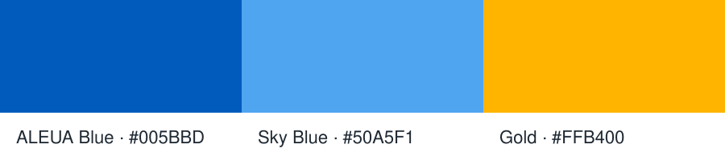
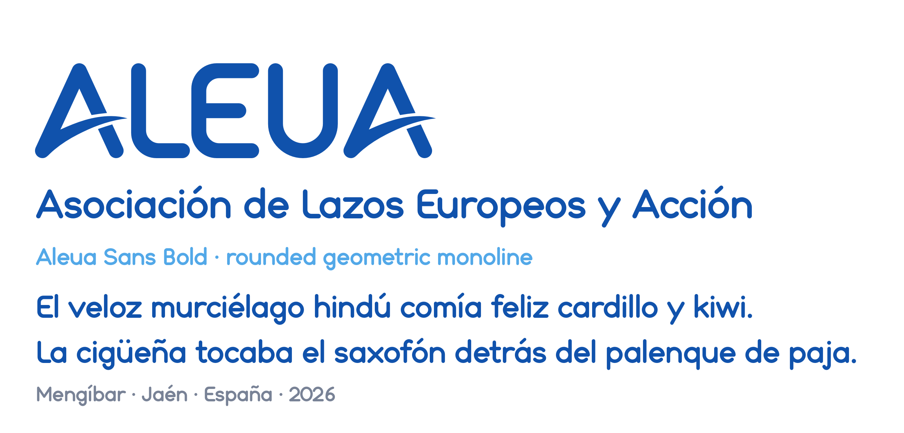

# ALEUA artwork


Visual identity assets of **Asociación ALEUA** (*Asociación de Lazos
Europeos y Acción*), Mengíbar, Jaén, Spain: the logo in all its
variants, the colour palette and **Aleua Sans**, the typeface designed
for the association's visual identity.

## Contents

```
aleua-artwork/
├── logos/
│   ├── imagotype/   logo with lettering (svg/, png/)
│   ├── isotype/     symbol only (svg/, png/)
│   ├── NOTICE.md    attribution and usage notice
│   └── LICENSE.txt  CC BY-ND 4.0 legal code
├── font/            Aleua Sans typeface (see font/README.md)
├── docs/            colour palette
└── tools/           scripts to rebuild and export the artwork
```

## Logos

### Imagotype (symbol and lettering)

| File | Use |
|------|-----|
| `aleua_img_colour` | full colour, transparent background (default) |
| `aleua_img_colour_bg` | full colour on a white background |
| `aleua_img_negative` | white on ALEUA Blue background |
| `aleua_img_black_bg` | white on a black background |
| `aleua_img_black_transparent` | black, transparent background |
| `aleua_img_white_transparent` | white, transparent background (for dark backgrounds and photos) |

### Isotype (symbol only)


| File | Use |
|------|-----|
| `aleua_logo_colour` | full colour, transparent background (default) |
| `aleua_logo_bg_colour` | full colour on a white square |
| `aleua_logo_bg_negative` | white on an ALEUA Blue square (avatars, app icons) |
| `aleua_logo_bg_black` | white on a black square |
| `aleua_logo_black` | black, transparent background |
| `aleua_logo_white` | white, transparent background |

Each file is available as SVG (vector, preferred) and PNG (100 dpi).
Use the SVG for print and any size change; use the PNG only where
vectors are not supported.

### Usage guidelines

- Choose the variant that fits the background instead of recolouring:
  colour on light backgrounds, white or negative on dark ones, black for
  single-colour printing.
- Scale proportionally; do not stretch, rotate, crop or rearrange the
  symbol and the lettering.
- Keep clear space around the logo of at least the height of the
  letter E of the lettering.
- Do not redraw the lettering with another typeface.

## Colour palette



| Name | HEX | RGB |
|------|-----|-----|
| ALEUA Blue | `#005BBD` | 0, 91, 189 |
| Sky Blue | `#50A5F1` | 80, 165, 241 |
| Gold | `#FFB400` | 255, 180, 0 |

Black (`#000000`) and white (`#FFFFFF`) are used for the monochrome
variants.

## Typeface



Aleua Sans is a rounded geometric monoline typeface derived from the
ALEUA lettering. Fonts, build sources and documentation are in
[`font/`](font); see [font/README.md](font/README.md). Its `ss01`
stylistic set reproduces the A of the logotype with its swoosh.

## Tools

Requirements: Python 3.10+ and `pip install -r requirements.txt`.

| Command | Purpose |
|---------|---------|
| `python3 tools/aleua_logo.py fix-a logos/imagotype/svg/*.svg` | Rebuild every A of the imagotype from the exact open A of Aleua Sans, keeping the gap where the swoosh crosses the right leg: straight edges in one segment, inner and outer slopes identical. |
| `python3 tools/aleua_logo.py extract-swoosh logos/imagotype/svg/aleua_img_colour.svg` | Measure the logo swoosh and gap and store them for the font (`font/sources/logo_swoosh.json`). Rebuild the font afterwards. |
| `python3 tools/export_png.py` | Render every logo SVG to PNG at 100 dpi (`--dpi` to change). |
| `python3 font/sources/build_aleua.py` | Build the Aleua Sans OTF and TTF. |

All scripts are checked with `pylint`.

## License

- **Logos and palette:** © 2026 Asociación ALEUA, licensed under
  [CC BY-ND 4.0](logos/LICENSE.txt). You may share them with
  attribution, but not distribute modified versions. See
  [logos/NOTICE.md](logos/NOTICE.md).
- **Aleua Sans and tools:** [SIL Open Font License 1.1](font/OFL.txt).

See [LICENSE.md](LICENSE.md) for the summary. Neither license grants
rights to the name "ALEUA" or to use the logos to suggest endorsement
by the association.

## Credits

All assets (Vector artwork, Aleua Sans typeface and Logo) are designed by Asociación ALEUA and its members. Credits to them.

* [Instagram](https://instagram.com/aleua.eu)
* [Facebook](https://facebook.com/aleua.eu)
