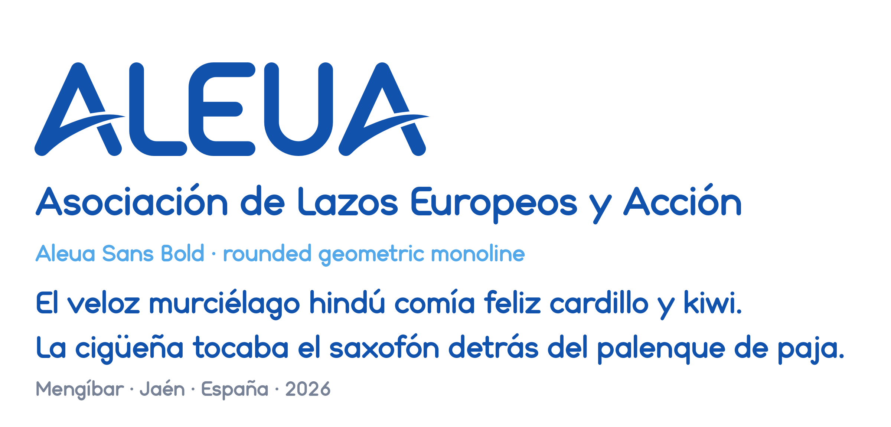
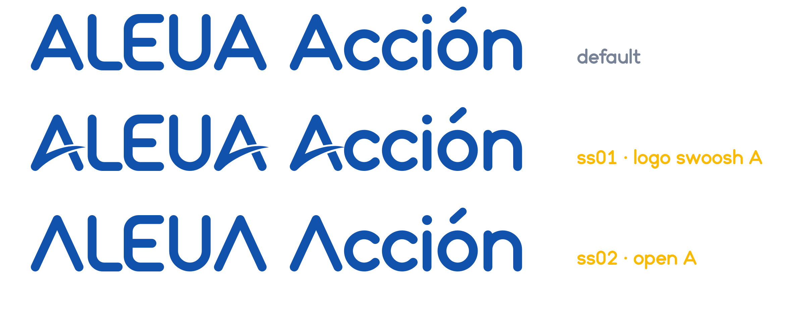
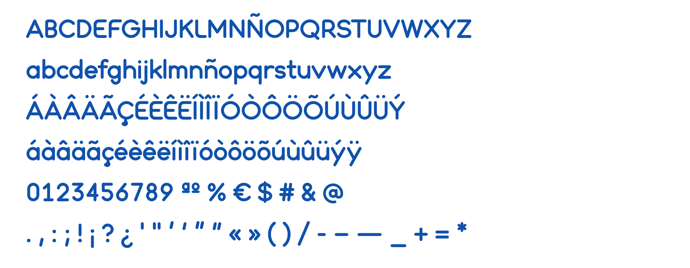

# Aleua Sans



**Aleua Sans** is a rounded geometric monoline typeface designed for the
visual identity of **Asociación ALEUA** (*Asociación de Lazos Europeos y
Acción*), based in Mengíbar, Jaén, Spain.

Its letterforms are derived from the ALEUA logotype: a constant stroke
with round terminals, soft outer corners and square inner joins. The
alphabet was extended from the four letters of the logotype (A, L, E, U)
into a complete typeface for Spanish and Western European Latin text.

The font is free and open source, released under the
[SIL Open Font License 1.1](OFL.txt). It is part of the
[aleua-artwork](../README.md) repository, next to the ALEUA logos.

## Features

- **One weight:** Bold (`usWeightClass` 700), matching the logotype.
- **Formats:** OpenType/CFF (`.otf`, cubic Bézier curves with exact
  fractional coordinates) and TrueType (`.ttf`, quadratic curves).
- **154 glyphs** covering Spanish and most Western European Latin text.
- **Tabular figures:** all digits share the same width (560 units) and
  the same bowl radius, so numbers line up in tables and do not shift
  in digital clocks.
- **Optical spacing and class-based kerning**, including tuned
  uppercase-to-lowercase transitions.
- **Exact symmetry:** symmetric letters (A, H, O, T, U, V, W, o, v, x…)
  and rotationally symmetric ones (N, Z, z) are identical on both sides,
  node by node.
- **Consistent vertical metrics:** cap height 700, x-height 510,
  ascenders 752, descenders −222 (units per em: 1000).

### Stylistic sets



| Feature | Effect |
|---------|--------|
| default | A with a crossbar, best for running text |
| `ss01` (also `salt`) | A of the ALEUA logotype: open A with the logo swoosh and the gap where it crosses the right leg |
| `ss02` | open A without crossbar, as in the logotype letter skeleton |

### Character set



```
A–Z a–z Ñ ñ
Á À Â Ä Ã Ç É È Ê Ë Í Ì Î Ï Ó Ò Ô Ö Õ Ú Ù Û Ü Ý
á à â ä ã ç é è ê ë í ì î ï ó ò ô ö õ ú ù û ü ý ÿ ı
0–9 ª º % € $ # & @
. , : ; · ! ¡ ? ¿ ' " ‘ ’ “ ” « » ( ) / - – — _ + = *
```

## Installation

Download the fonts from the [`fonts/`](fonts) folder (or from the
latest release) and install the format you prefer. The `.otf` is
recommended for design work; the `.ttf` works everywhere.

- **Linux:** copy the file to `~/.local/share/fonts/` and run
  `fc-cache -f`.
- **macOS:** double-click the file and choose *Install Font*.
- **Windows:** right-click the file and choose *Install*.

Applications such as Inkscape cache fonts: restart them after installing
or updating the font.

## Usage

### Stylistic sets in applications

- **Inkscape:** *Text → Text and Font…*, *Features* tab (*Variants* in
  older versions); enable or type `ss01` or `ss02`.
- **LibreOffice:** set the font name to `Aleua Sans:ss01`.
- **Adobe apps:** *OpenType* panel → *Stylistic Sets*.

### Web

Convert the TTF to WOFF2 with [fontTools](https://github.com/fonttools/fonttools):

```sh
pip install fonttools brotli
fonttools ttLib.woff2 compress fonts/ttf/AleuaSans-Bold.ttf
```

```css
@font-face {
  font-family: "Aleua Sans";
  src: url("AleuaSans-Bold.woff2") format("woff2");
  font-weight: 700;
  font-style: normal;
  font-display: swap;
}

.logo-text {
  font-family: "Aleua Sans", sans-serif;
  font-weight: 700;
  font-feature-settings: "ss01";
}
```

## Building from source

The fonts are generated entirely by Python scripts in
[`sources/`](sources). Requirements: Python 3.10+ and the packages in
[`requirements.txt`](requirements.txt).

```sh
python3 -m venv .venv && . .venv/bin/activate
pip install -r requirements.txt
python3 sources/build_aleua.py          # writes fonts/otf and fonts/ttf
python3 tools/make_specimen.py          # refreshes docs/images
```

`build_aleua.py --output-dir DIR` writes the fonts elsewhere.
`make_specimen.py` needs Pillow built with libraqm to show kerning and
stylistic sets.

### How the build works

| Module | Role |
|--------|------|
| `build_aleua.py` | Glyph skeletons on a design grid, accents, glyph table, OpenType features and the command line entry point. |
| `aleua_symmetry.py` | Detects mirror and rotational symmetry and enforces it on geometry and on every fitted point. |
| `aleua_spacing.py` | Optical side bearings, kerning (one white-space model) and the generated `kern` feature. |
| `aleua_curves.py` | Fits clean cubic Bézier curves to the outlines, with nodes on extrema, corners and line joins. |
| `aleua_output.py` | Writes the OTF (CFF) and TTF (glyf) files, metadata and metrics; rounds TTF points so straight edges keep their slope. |
| `aleua_logo_a.py` | Builds the `ss01` A: open A, gap and swoosh of the logotype. |
| `logo_swoosh.json` | Swoosh and gap of the logotype A, in font units, used by `ss01`. Generated with `../tools/aleua_logo.py extract-swoosh` from the imagotype SVG. |

1. Every glyph is drawn as centre-line strokes. Strokes are expanded to
   a 110-unit monoline with round caps; soft corners get rounded inner
   and outer radii, as in the logotype.
2. Symmetric glyphs are rebuilt from one half so both sides match
   exactly.
3. Side bearings and kerning are measured from the white space next to
   each glyph, so straight, round and open shapes space evenly.
4. Outlines are fitted with Bézier curves and saved as OTF and TTF.

All code is checked with `pylint`.

## Known limitations

- Single weight (Bold) and no italic.
- Latin only. Not yet included: ``< > [ ] { } | \ ^ ` ~``, Greek
  and Cyrillic, and Central/Eastern European accents.
- TrueType stores whole-number coordinates. The build rounds the end
  points of straight edges so they keep their slope (long parallel
  edges match within a few hundredths of a degree), but very short
  segments, such as the pieces next to the swoosh gap of `ss01`, can
  still deviate by up to about 1°. The `.otf` is exact; prefer it for
  design work.

## License

The fonts, the source scripts and the documentation in this repository
are Font Software licensed under the
[SIL Open Font License, Version 1.1](OFL.txt). You may use, study,
modify and redistribute them freely, including in commercial work; the
fonts may not be sold by themselves, and modified versions must remain
under the OFL.

See [AUTHORS.txt](AUTHORS.txt) for the project authors and
[FONTLOG.txt](FONTLOG.txt) for the change history.

## Acknowledgements

Designed for the visual identity of Asociación ALEUA (Asociación de
Lazos Europeos y Acción), Mengíbar, Jaén, Spain.
